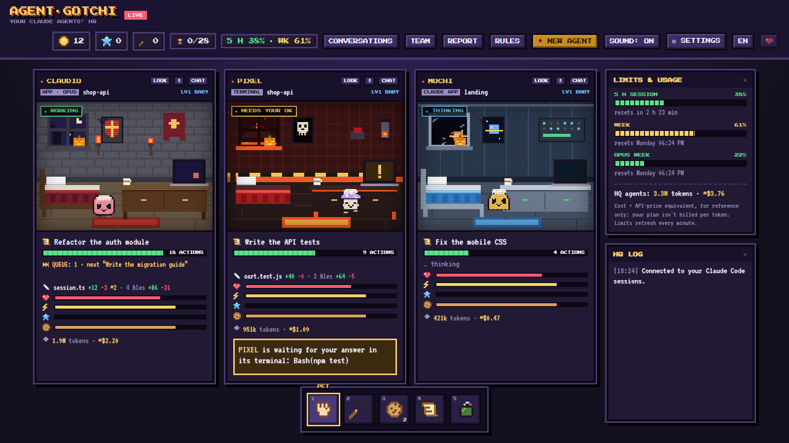

# Agent·Gotchi

**A Tamagotchi-style HQ for your Claude Code agents.**

Every Claude Code session you run becomes a little pixel creature living in its own room, behind a security camera. You watch them work, think, slack off and fall asleep. You give them quests, feed them treats, crack the whip when they stop too early, and answer their permission requests without leaving the HQ.

It's a game on the surface and a real control room underneath: live usage limits, changed files with diffs, a quest queue, permission rules, team missions, voice dictation and a daily report.



> **Windows and macOS** (the macOS app is new: feedback welcome). Free for personal and noncommercial use, source available. Not affiliated with Anthropic or Bandai.

[](https://github.com/ijohjo/agent-gotchi/releases/latest)
[](https://paypal.me/johmedia)

**Enjoying Agent·Gotchi?** It's free and always will be. If you'd like to support its creator, you can [leave a tip on PayPal](https://paypal.me/johmedia) ♥. Entirely optional, and very much appreciated.

---

## Features

**Your agents, alive**
- One camera per Claude Code session (terminal, Claude desktop app, or agents started from Agent·Gotchi itself), up to 6 at a time.
- Real states mapped to animations: working, thinking, waiting for your OK, slacking, asleep.
- Needs (mood, energy, XP, hunger), five personalities, companions, visits between rooms, seasonal events and the occasional boss bug.
- Agents level up and evolve: BABY → JUNIOR → PRO → CHAMPION → LEGEND. You can switch back to any form you've unlocked if you prefer an older one.
- 12 animated rooms, room layouts and a shop of accessories, paid with coins earned from finished quests, squashed bugs and achievements.
- 28 achievements.

**Talk to them**
- **Quests**: send a task to any agent. Finished quests earn coins and XP.
- **Whip**: when an agent stops too early, a crack of the whip tells it to resume and finish (or to check its work).
- **Treat**: tell an agent you like what it did.
- **Chat**: write to an agent from the HQ, like in Claude Code. Conversations are saved in Claude as usual.
- **Wake-up**: a message sent from the HQ wakes an idle session right away, terminal or desktop app (one-time opt-in, see below).
- **Voice**: push-to-talk dictation (global hotkey on Windows), hands-free mode ("Gotchi, run the tests"), and agents that read their answers aloud, each with its own voice.

**Control room**
- **Usage limits**: your 5-hour session and weekly limits, with alerts and an automatic queue pause near the cap.
- **Changes**: files touched by each agent, with a git diff and a one-click "undo changes to this file".
- **Permissions**: answer Allow / Always / Deny from the camera, or by voice ("yes" / "no").
- **Permission rules**: allow, ask or deny tools automatically (e.g. allow reads, deny `rm`, ask before `git push`).
- **Quest queue** and **scheduled quests** ("every weekday at 9:00, run the tests").
- **Team missions**: split a big goal into parts (Claude Haiku suggests the split) and launch several agents on it in parallel.
- **Daily report** of everything your agents did, copyable.
- **Conversation browser** with full-text search, plus import of your claude.ai export to continue an old conversation in an agent.
- Compact cards and a mini window to keep in a corner while you work.

**Languages**: English and French (switch with the button in the top bar). Agents are spoken to in the language you pick.

---

## Requirements

| | |
|---|---|
| **OS** | Windows 10 or 11, or macOS 11 (Big Sur) or newer (Apple Silicon or Intel) |
| **Node.js** | 20 or newer (tested on 24). [Download](https://nodejs.org/) |
| **Claude Code** | The `claude` CLI, installed and logged in (`claude auth login`). [Docs](https://docs.claude.com/en/docs/claude-code) |
| **Browser** | For the app window: Microsoft Edge on Windows (preinstalled); on macOS, Google Chrome, Edge, Brave, Chromium or Arc (Safari can't open app windows, so it opens as a normal tab). Any modern browser works at `http://localhost:5178`. |
| **Optional** | [whisper.cpp](https://github.com/ggml-org/whisper.cpp) for high-accuracy local dictation (fast with an NVIDIA GPU on Windows, or Metal on Apple Silicon). Without it, Windows uses its own speech recognition; on macOS, dictation needs Whisper. |

---

## Installation

### The easy way: let Claude Code install it

Open Claude Code (terminal or desktop app) and paste this:

```text
Install Agent·Gotchi for me from https://github.com/ijohjo/agent-gotchi
Follow the "Instructions for Claude Code" section of its README exactly.
```

#### Instructions for Claude Code

If you are Claude Code installing this project for a user, do exactly this, and tell the user what you're doing at each step:

1. Check the machine: Windows 10/11 or macOS 11+, `node -v` is 20 or newer, and `claude` is on the PATH. If Node.js is missing or too old, stop and ask the user to install it from https://nodejs.org/ (don't install it silently).
2. Clone the repo into `%USERPROFILE%\Documents\agent-gotchi` on Windows or `~/Documents/agent-gotchi` on macOS (or a folder the user picks): `git clone https://github.com/ijohjo/agent-gotchi.git`. If git isn't available, download the ZIP of the `main` branch and extract it there.
3. Explain to the user that the next step adds hooks to `~/.claude/settings.json` (a backup is made first and their other hooks are kept), then run `node install.js` from the project folder. Do **not** edit `settings.json` by hand. If running it is blocked or refused, ask the user to run `node install.js` themselves in that folder.
4. Tell the user to start the HQ with `node server.js --app` from the project folder (or by opening `AgentGotchi.exe` / `AgentGotchi.app` from the [latest release](https://github.com/ijohjo/agent-gotchi/releases/latest)), and to **restart their Claude Code sessions** so the hooks load. Their agents then appear in the HQ.
5. Mention that everything runs locally and that `node install.js --uninstall` removes the hooks.

### Manual installation

#### 1. Get the files

```bash
git clone https://github.com/ijohjo/agent-gotchi.git
cd agent-gotchi
```

Or download the ZIP from GitHub (green **Code** button → **Download ZIP**) and extract it somewhere permanent, for example `Documents\agent-gotchi`.

There is nothing to `npm install`: Agent·Gotchi uses only Node's built-in modules.

#### 2. Install the Claude Code hooks

```bash
node install.js
```

This adds Agent·Gotchi's hooks to `~/.claude/settings.json` so your sessions can report to the HQ. It:
- makes a backup first (`settings.json.gotchi-backup-<date>`),
- leaves your other hooks untouched,
- copies `hook.js` to `~/.claude/hooks/agent-gotchi/`.

**Restart your Claude Code sessions** afterwards so they pick up the hooks.

#### 3. Start the HQ

```bash
node server.js
```

Then open **http://localhost:5178**. Start a `claude` session in a terminal (or send a message in an open one) and your agent walks into the HQ.

To open it as a standalone window that closes the server when you close it:

```bash
node server.js --app
```

#### 4. (Optional) Use the ready-made app (Windows .exe or macOS .app)

A ready-made **AgentGotchi.exe** is attached to each [release](https://github.com/ijohjo/agent-gotchi/releases/latest). Windows may show a SmartScreen warning because it isn't code-signed: **More info → Run anyway**.

To build it yourself instead:

```bash
node build.js
```

This creates `dist\AgentGotchi.exe` (Node single executable, with its own icon and no console window). Double-click it to open the HQ. Building downloads two small build tools (`rcedit`, `postject`) into `build\node_modules`.

**On macOS**, each release also has **AgentGotchi-macOS-arm64.zip** (Apple Silicon: M1 and later) and **AgentGotchi-macOS-x64.zip** (Intel Macs). Unzip it and move **AgentGotchi.app** to your Applications folder. The app isn't notarized by Apple, so the first time macOS blocks it: **right-click the app → Open → Open**, or run:

```bash
xattr -dr com.apple.quarantine /Applications/AgentGotchi.app
```

The app has no Dock icon of its own: it opens the HQ in a Chrome-style app window, and the server stops a few seconds after you close that window. To build it yourself on a Mac, run `node build.js` (it creates `dist/AgentGotchi.app` and a zip, for your Mac's processor). The **Build macOS app** GitHub Action builds both versions and attaches them to each new release.

> The hooks still run with Node, so keep Node.js installed and run `node install.js` once, even if you use the `.exe` or the `.app`.

#### 5. (Optional) Enable wake-up

By default, a message you send to an idle terminal session waits until that session moves again. Click **ENABLE WAKE-UP** in the app (it appears when needed) to add one more hook that wakes the session immediately. It's the same as reinstalling with `node install.js`, which already includes it.

#### 6. (Optional) Local Whisper dictation

Put whisper.cpp in `~/.claude/hooks/agent-gotchi/whisper/`:

```
whisper/
  bin-cuda/   whisper-server.exe and its DLLs (NVIDIA GPU build)   ← preferred
  bin/        whisper-server.exe and its DLLs (CPU build)          ← fallback
  models/     ggml-large-v3-turbo-q8_0.bin  or  ggml-large-v3-turbo-q5_0.bin
```

Builds are on the [whisper.cpp releases page](https://github.com/ggml-org/whisper.cpp/releases), models on [Hugging Face](https://huggingface.co/ggerganov/whisper.cpp). Agent·Gotchi detects them on start and starts a local Whisper server; your voice never leaves your computer.

**On macOS**, install whisper.cpp with [Homebrew](https://brew.sh/) (`brew install whisper-cpp`, Metal-accelerated on Apple Silicon) and put a model in `~/.claude/hooks/agent-gotchi/whisper/models/`. Agent·Gotchi finds Homebrew's `whisper-server` on its own. The browser asks for microphone access the first time you dictate. The global push-to-talk key is Windows-only: on macOS, the key works while the HQ window is in front.

---

## Updating

Pull the new version (or download the new ZIP), then run `node install.js` again and restart your Claude sessions. The hook file is also refreshed automatically each time the server starts.

## Uninstalling

```bash
node install.js --uninstall
```

This removes only Agent·Gotchi's hooks from `settings.json` (with a backup). You can then delete the project folder and `~/.claude/hooks/agent-gotchi/` (which holds the chat log, game state and optional Whisper files). Game progress (coins, looks, achievements) is stored in the browser: for the app window, in its browser profile at `%LOCALAPPDATA%\AgentGotchi` on Windows or `~/Library/Application Support/AgentGotchi` on macOS.

---

## Important notes

**Everything runs on your machine.**
- The server listens on `127.0.0.1` only, rejects requests from other hostnames (anti DNS-rebinding) and requires a random token that changes on every start.
- No telemetry, no analytics, no account.

**What it reads, and why**
- Your Claude Code transcripts in `~/.claude/projects/`, to show conversations, token usage and the daily report.
- `~/.claude/.credentials.json` (the Claude CLI login), **only** to call `api.anthropic.com/api/oauth/usage` and display your usage limits. The token is never sent anywhere else. The **RENEW LOGIN** button refreshes it with a tiny Haiku request.
- `~/.claude/settings.json`, only when you run `install.js` or click **ENABLE WAKE-UP** (always with a backup).

**What it can change**
- **Whip, treat, quests and chat** inject short messages into your agent's conversation. They use a few tokens like any message.
- **Permission rules** you create can also apply to terminal sessions if you tick that option: an "allow" rule then skips Claude Code's own permission prompt. Be careful with broad rules.
- **UNDO CHANGES TO THIS FILE** runs `git restore` on that file: uncommitted changes to it are lost (you're asked to confirm).
- **Team missions** and agents started from the app run the real `claude` CLI and count toward your usage like any session.
- **Costs** shown in the app are API-price equivalents for reference. Your Claude plan isn't billed per token.

**Good to know**
- The hooks never block Claude: if the HQ is closed, they exit silently in milliseconds.
- While the HQ is open, a finished session waits up to 20 seconds for a possible whip before stopping (set `GOTCHI_GRACE` to change it).
- With wake-up enabled, each idle session keeps a tiny background listener (up to 12 hours) so it can be woken from the HQ.
- The pixel fonts load from Google Fonts; offline, the app falls back to a monospace font.
- The grenade is purely cosmetic. It has no effect on the real Claude.

### Environment variables

| Variable | Default | |
|---|---|---|
| `GOTCHI_PORT` | `5178` | Server port (Whisper uses port + 2) |
| `GOTCHI_GRACE` | `20` | Seconds a finished session waits for a whip |
| `GOTCHI_APP` | unset | `1` does the same as `--app`: opens the app window and stops the server when it closes |
| `GOTCHI_HOOK_DIR` | `~/.claude/hooks/agent-gotchi` | Where the hook, token and state live |

---

## Project structure

```
index.html      The whole game: UI, pixel art, sounds, translations
server.js       Local server: receives hooks, streams state to the page, talks to the claude CLI
hook.js         Claude Code hook: forwards each event to the server
install.js      Installs / removes the hooks in ~/.claude/settings.json
build.js        Builds dist/AgentGotchi.exe on Windows or dist/AgentGotchi.app on macOS (Node SEA)
tools/          Translation helpers (en.js is the English dictionary)
```

Translations: French is the source language. English strings live in `tools/en.js`; run `node tools/i18n-inject.js` to copy them into `index.html`.

---

## Support the project

Agent·Gotchi is free and will stay free. If it makes your day with Claude Code a bit more fun and you'd like to say thanks, you can [buy me a coffee on PayPal](https://paypal.me/johmedia). Completely optional.

Bug reports and ideas are welcome in [Issues](https://github.com/ijohjo/agent-gotchi/issues).

## Credits

Created by **Johjo**: [website](https://www.media-buyer.fr) · [GitHub](https://github.com/ijohjo) · [Instagram](https://www.instagram.com/joh.media/) · [LinkedIn](https://www.linkedin.com/in/johan-alves-media)

Fonts: [Press Start 2P](https://fonts.google.com/specimen/Press+Start+2P) by CodeMan38 and [VT323](https://fonts.google.com/specimen/VT323) by Peter Hull, both under the SIL Open Font License, loaded from Google Fonts.

Claude and Claude Code are products of Anthropic. Tamagotchi is a trademark of Bandai. Agent·Gotchi is an independent fan project, not affiliated with or endorsed by either.

## License

[PolyForm Noncommercial 1.0.0](LICENSE): free to use, modify and share for any **noncommercial** purpose (personal use, hobby projects, study, research, nonprofits, schools).

**Commercial use is not allowed** without permission: no selling it, no bundling it into a paid product or service. For a commercial license, get in touch through [media-buyer.fr](https://www.media-buyer.fr).
